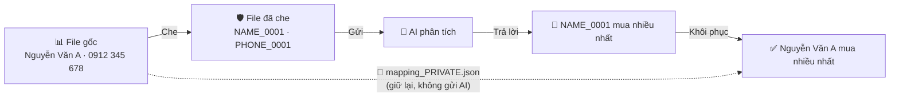
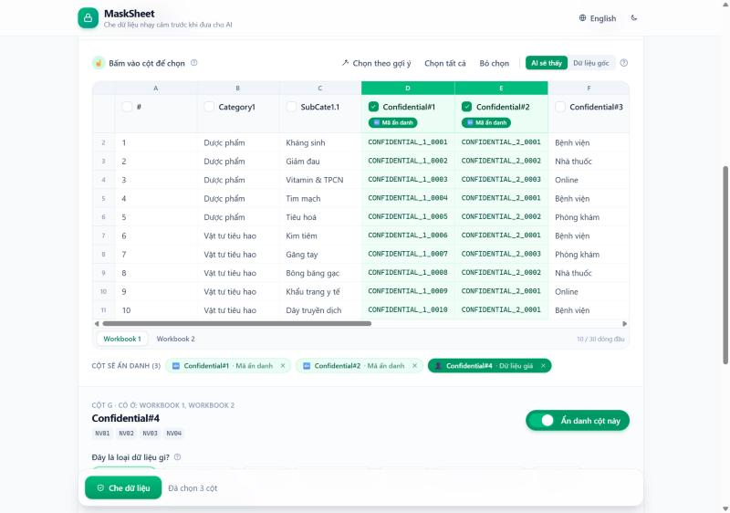
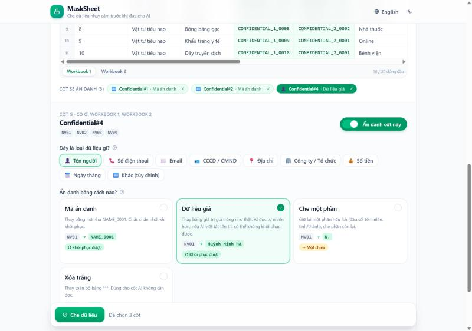

<div align="center">

# 🔒 MaskSheet

### Đưa Excel cho AI mà không lộ dữ liệu

**[🚀 Dùng ngay → marksheet-two-beta.vercel.app](https://marksheet-two-beta.vercel.app/)**

[](https://marksheet-two-beta.vercel.app/)
[](LICENSE)


[Tiếng Việt](#-tiếng-việt) · [English](#-english)


</div>

---

## 🇻🇳 Tiếng Việt

### Vấn đề

Bạn muốn nhờ ChatGPT, Claude hay Gemini phân tích một file Excel, nhưng file chứa tên khách hàng, số điện thoại, CCCD, doanh số… Những thông tin này không được phép đưa ra ngoài công ty.

### Giải pháp

**MaskSheet** thay dữ liệu nhạy cảm bằng mã ẩn danh hoặc dữ liệu giả **ngay trong trình duyệt**. Sau khi AI trả lời, bạn khôi phục về giá trị thật chỉ với một cú nhấp.



### ✨ Tính năng

| | |
|---|---|
| 🔐 **100% trên trình duyệt** | Không backend, không upload, không analytics. Được khóa bằng Content-Security-Policy. |
| 🎯 **Nhất quán** | Cùng một giá trị luôn ra cùng một mã, kể cả ở sheet khác có cùng tên cột. AI vẫn đếm, nhóm, so sánh đúng. |
| 🧰 **9 cách che** | Mã ẩn danh, dữ liệu giả, che một phần, xóa trắng, nhân hệ số, làm tròn, khoảng giá trị, dịch ngày, chỉ giữ tháng. |
| 🪄 **Tự nhận diện cột** | Gợi ý loại dữ liệu từ tên cột (Họ tên, SĐT, CCCD…) và nội dung (email, SĐT Việt Nam, ngày tháng). |
| 🖱️ **Chọn cột kiểu Excel** | File hiện dạng bảng tính; bấm thẳng vào tiêu đề cột (A, B, C…) để chọn. Cột đã chọn hiển thị ngay "AI sẽ thấy gì". |
| 👀 **Xem trước trực tiếp** | Mỗi cách che có ví dụ thật lấy từ dữ liệu của bạn, chuyển nhanh giữa "AI sẽ thấy" và "Dữ liệu gốc". |
| ↺ **Khôi phục từ text hoặc file** | Dán câu trả lời của AI hoặc tải file .xlsx/.csv AI trả về. |
| 🛡️ **Kiểm tra an toàn** | Cảnh báo SĐT/email/CCCD còn sót ở cột chưa che; từ chối khi dữ liệu gốc đã có chuỗi giống mã; báo mã do AI tự bịa ra. |
| ⚡ **File lớn** | Xử lý trong Web Worker, có thanh tiến trình, UI không bị treo. |
| 🌗 **Thân thiện** | Tiếng Việt / English, giao diện sáng/tối, dùng tốt trên điện thoại, có hướng dẫn khi di chuột. |

### 🧰 Các cách che dữ liệu

| Cách che | Ví dụ | Khôi phục | Dùng khi |
|---|---|:---:|---|
| **Mã ẩn danh** | `Nguyễn Văn A` → `NAME_0001` | ✅ | Mặc định, chắc chắn nhất |
| **Dữ liệu giả** | `Nguyễn Văn A` → `Trần Minh Khoa` | ✅ | Muốn AI đọc tự nhiên (tên, SĐT, email, CCCD, công ty, địa chỉ) |
| **Che một phần** | `0912345678` → `091****678`<br/>`an@gmail.com` → `a***@gmail.com`<br/>`12 Lê Lợi, Huế` → `***, Huế` | ❌ | Cần giữ đầu số, tên miền, tỉnh/thành để phân tích |
| **Xóa trắng** | `Ghi chú nội bộ` → `***` | ❌ | AI không cần đọc cột này |
| **Nhân hệ số bí mật** | `5,000,000` → `4,121,000` | ✅ | Số tiền: tổng, tỉ lệ, Giá × SL vẫn đúng tương đối |
| **Làm tròn** | `7,425,000` → `7,400,000` | ❌ | Chỉ cần độ lớn |
| **Khoảng giá trị** | `7,425,000` → `5,000,000–10,000,000` | ❌ | Phân nhóm theo mức |
| **Dịch ngày bí mật** | `01/10/2026` → `11/04/2026` | ✅ | Giữ khoảng cách giữa các ngày |
| **Chỉ giữ tháng/năm** | `15/03/1990` → `03/1990` | ❌ | Ngày sinh, thống kê theo tháng |

> Mọi cột tiền dùng **chung một hệ số**, mọi cột ngày dùng **chung một độ dịch**, nên quan hệ giữa các cột (ví dụ `Doanh thu = Giá × SL`) vẫn giữ nguyên.

### 📖 Cách dùng



1. **Che dữ liệu**
   - Mở **[MaskSheet](https://marksheet-two-beta.vercel.app/)** rồi kéo thả file `.xlsx`, `.xls` hoặc `.csv` vào (hoặc bấm *Thử với file mẫu*).
   - **Bấm vào tiêu đề cột** (hoặc bất kỳ ô nào) trên bảng để chọn cột cần ẩn danh, giống chọn cột trong Excel. Bấm lại cột đang chọn để bỏ chọn. Hoặc bấm *Chọn theo gợi ý*.
   - Ở khung bên dưới bảng, chọn **loại dữ liệu** và **cách ẩn danh**. Mỗi cách đều có ví dụ thật lấy từ file của bạn.
   - Bảng hiển thị luôn *AI sẽ thấy gì*. Kiểm tra xong thì bấm **Che dữ liệu**.
   - Tải về 2 file:
     - `…_masked.xlsx`: gửi file này cho AI.
     - `…_mapping_PRIVATE.json`: giữ riêng, **không gửi AI**.
2. **Gửi cho AI:** tải file `_masked` lên ChatGPT, Claude hay Gemini và đặt câu hỏi như bình thường.
3. **Khôi phục**
   - Mở tab **Khôi phục** và tải file mapping lên.
   - Dán câu trả lời của AI, hoặc tải file kết quả AI trả về.
   - Nhận lại văn bản hoặc file với giá trị thật.



### 🔐 Quyền riêng tư & bảo mật

- **Không có server.** File được đọc bằng `ArrayBuffer` và xử lý trong Web Worker ngay trên máy bạn.
- **Content-Security-Policy `connect-src 'self'`.** Trình duyệt **chặn** mọi kết nối tới domain khác, nên dữ liệu không thể bị gửi đi kể cả khi có script lạ. Bạn có thể kiểm tra trong DevTools → Network, hoặc ngắt mạng sau khi trang đã tải.
- **Không font, CDN hay analytics bên ngoài.**
- **File xuất "sạch":** công thức, ghi chú, hyperlink, named range và thông tin tác giả đều bị loại bỏ.
- **Hệ số bí mật và mã giả** được sinh bằng `crypto.getRandomValues`.

> ⚠️ **File mapping chứa toàn bộ dữ liệu gốc.** Hãy lưu ở nơi an toàn và **không bao giờ** gửi cho AI.
>
> MaskSheet thực hiện *giả danh hóa* (pseudonymization), không phải ẩn danh tuyệt đối. Tần suất và quan hệ giữa các dòng vẫn được giữ lại, đó chính là điều giúp AI phân tích được. Với dữ liệu cực kỳ nhạy cảm, hãy ưu tiên các cách che một chiều.

### 🛠️ Chạy local

Yêu cầu **Node.js 20+**.

```bash
git clone https://github.com/HoangPhucTony/MaskSheet.git
cd MaskSheet
npm install
npm run dev        # http://localhost:5173
```

| Lệnh | Mô tả |
|---|---|
| `npm run dev` | Chạy server phát triển |
| `npm test` | Chạy unit test (Vitest) |
| `npm run build` | Kiểm tra kiểu + build static vào `dist/` |
| `npm run preview` | Xem bản build (có CSP) tại http://localhost:4173 |

### 🚀 Deploy

**Vercel (khuyên dùng)**
1. Fork repo này.
2. Vào [vercel.com/new](https://vercel.com/new) và import repo. Vercel tự nhận Vite.
3. Bấm Deploy. File `vercel.json` đã cấu hình sẵn CSP và các header bảo mật.

**GitHub Pages / Cloudflare Pages / Netlify:** thư mục `dist/` là static thuần, dùng đường dẫn tương đối (`base: './'`) nên chạy được ở sub-path. CSP được nhúng sẵn qua thẻ `<meta>`.

### 🏗️ Kiến trúc

```
src/
├── lib/                 # Logic thuần TypeScript, không phụ thuộc DOM, có unit test
│   ├── masker.ts        # Che dữ liệu, tạo file mapping
│   ├── unmasker.ts      # Khôi phục từ workbook hoặc văn bản
│   ├── fake.ts          # Sinh dữ liệu giả tiếng Việt (không trùng lặp)
│   ├── partial.ts       # Che một phần
│   ├── dates.ts         # Dịch ngày, chỉ giữ tháng
│   ├── money.ts         # Hệ số, làm tròn, khoảng giá trị
│   ├── detectType.ts    # Tự nhận diện loại cột
│   └── mapping.ts       # Schema + kiểm tra file mapping
├── workers/             # mask.worker.ts, unmask.worker.ts
├── components/          # Giao diện React
└── i18n/                # vi, en
tests/                   # Vitest
```

**Tech stack:** Vite · React 19 · TypeScript · Tailwind CSS 4 · SheetJS · Web Workers · Vitest

### ⚠️ Giới hạn hiện tại

- SheetJS bản cộng đồng không giữ màu sắc và định dạng ô; chỉ giữ giá trị và định dạng số.
- File `.xlsx` được đọc toàn bộ vào bộ nhớ, nên file rất lớn (trên 50MB) nên lưu thành CSV trước.
- Dòng đầu tiên của mỗi sheet được coi là dòng tiêu đề.
- Với *dữ liệu giả*, nếu AI viết tắt hoặc chỉ gọi tên (vd. "anh Khoa") thì phần đó sẽ không được khôi phục. Dùng *mã ẩn danh* nếu cần chắc chắn.

### 🗺️ Lộ trình

- [ ] Mã hóa file mapping bằng mật khẩu (Web Crypto)
- [ ] Đọc CSV rất lớn theo luồng (streaming)
- [ ] Chọn dòng tiêu đề khác dòng 1
- [ ] Hỗ trợ file Word / PDF

### 🤝 Đóng góp

Mọi đóng góp đều được hoan nghênh! Xem [CONTRIBUTING.md](CONTRIBUTING.md). Nguyên tắc quan trọng nhất: **không bao giờ gửi dữ liệu người dùng ra khỏi trình duyệt**.

---

## 🇬🇧 English

**[🚀 Try it live → marksheet-two-beta.vercel.app](https://marksheet-two-beta.vercel.app/)**

MaskSheet replaces sensitive values in Excel/CSV files with anonymous codes or realistic fake data **inside your browser**, so you can safely ask ChatGPT, Claude or Gemini to analyse them. When the AI answers, restore the real values in one click.

### Features

- 🔐 **100% client-side.** No backend, no upload, no analytics, enforced by a `connect-src 'self'` Content-Security-Policy.
- 🎯 **Consistent.** The same value always gets the same code, across columns and sheets, so the AI can still count, group and compare.
- 🧰 **9 masking methods**, listed below.
- 🪄 **Auto-detects** names, phones, emails, national IDs, addresses, companies, amounts and dates.
- 🖱️ **Excel-like column picking.** The file is shown as a spreadsheet; click column headers (A, B, C…) to select them and instantly see what the AI will get.
- 👀 **Live preview.** Every method shows a real example taken from your data.
- ↺ **Restore** from pasted AI text or from returned `.xlsx`/`.csv` files.
- 🛡️ **Safety checks.** Warns about PII left in unmasked columns, refuses when the data already contains code-like text, and reports codes the AI invented.
- ⚡ **Web Workers** with progress, so large files don't freeze the page.
- 🌗 **Easy to use.** Vietnamese / English, light & dark themes, mobile friendly, hover tooltips everywhere.

### Masking methods

| Method | Example | Reversible |
|---|---|:---:|
| Anonymous code | `Nguyễn Văn A` → `NAME_0001` | ✅ |
| Fake data | `Nguyễn Văn A` → `Trần Minh Khoa` | ✅ |
| Partial mask | `0912345678` → `091****678` | ❌ |
| Redact | `…` → `***` | ❌ |
| Secret multiplier (amounts) | `5,000,000` → `4,121,000` | ✅ |
| Round | `7,425,000` → `7,400,000` | ❌ |
| Value range | `7,425,000` → `5,000,000–10,000,000` | ❌ |
| Secret date shift | `01/10/2026` → `11/04/2026` | ✅ |
| Month/year only | `15/03/1990` → `03/1990` | ❌ |

All amount columns share one factor and all date columns share one offset, so cross-column relationships such as `Revenue = Price × Qty` still hold.

### How to use

1. **Mask:** open a file, click the sensitive columns in the spreadsheet, pick a type and method below it, then click **Mask data**. Download `_masked.xlsx` (for the AI) and `_mapping_PRIVATE.json` (keep it private).
2. **Ask AI:** upload the masked file to your AI assistant.
3. **Restore:** in the **Restore** tab, load the mapping, then paste the AI's answer or upload its result file.

### Privacy

No server ever sees your data. The CSP makes the browser block every request to another origin. **The mapping file contains all original values: never send it to an AI.** MaskSheet performs pseudonymization; frequencies and relationships between rows are preserved by design.

### Development

```bash
npm install
npm run dev      # dev server
npm test         # unit tests
npm run build    # type-check + static build in dist/
```

Deploy by importing the repo at [vercel.com/new](https://vercel.com/new). `vercel.json` sets the security headers. `dist/` also works as-is on GitHub Pages, Cloudflare Pages or Netlify.

---

<div align="center">

**[MIT License](LICENSE)** · Made with ❤️ for people who care about their data

</div>
