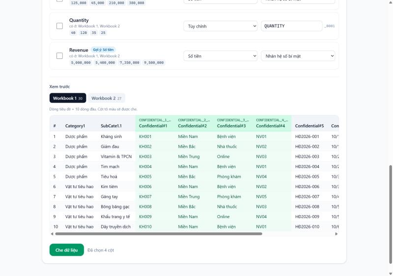

# MaskSheet

**Che dữ liệu nhạy cảm trong Excel/CSV trước khi đưa cho AI — rồi khôi phục lại kết quả.**
Chạy 100% trên trình duyệt. Không backend, không upload, không analytics.

[Tiếng Việt](#tiếng-việt) · [English](#english)


---

## Tiếng Việt

### Vấn đề

Bạn muốn nhờ ChatGPT/Claude/Gemini phân tích một file Excel, nhưng file có mã khách hàng, tên, số điện thoại, doanh số… không được phép đưa ra ngoài.

### Cách MaskSheet giải quyết

1. **Che**: tải file lên, tick các cột nhạy cảm. Mỗi giá trị được thay bằng một mã ẩn danh như `NAME_0001`.
   - Cùng một giá trị → **luôn cùng một mã** (kể cả ở sheet khác có cùng tên cột).
   - Giá trị khác nhau → mã khác nhau.
   - Vị trí dòng/cột, tên sheet, các cột không tick: **giữ nguyên**.
2. Đưa file `_masked.xlsx` cho AI. AI vẫn đếm, nhóm, so sánh, tính tổng được như bình thường.
3. **Khôi phục**: dán câu trả lời của AI (hoặc tải file kết quả) cùng file `_mapping_PRIVATE.json` → mọi mã được thay về giá trị thật.



### Tính năng

- Đọc `.xlsx`, `.xls`, `.csv` (UTF-8 hoặc Windows-1258), nhiều sheet.
- Tự gợi ý loại cột từ tên cột (Họ tên, SĐT, Email, CCCD, Địa chỉ, Công ty, Số tiền…) và từ nội dung (regex email / SĐT Việt Nam / CCCD).
- Chuẩn hóa trước khi so sánh: khoảng trắng thừa, Unicode dựng sẵn/tổ hợp; email không phân biệt hoa thường; SĐT `0912 345 678` = `+84912345678`.
- **Số tiền** có 3 chế độ:
  - *Nhân hệ số bí mật*: mọi cột tiền dùng **chung một hệ số** ngẫu nhiên (0.5–0.9 hoặc 1.1–2.0), nên `Doanh thu = Giá × SL` và các phép cộng vẫn đúng tỉ lệ. Khi khôi phục file, cột cùng tên được chia ngược tự động; với text có ô đổi số.
  - *Thay bằng mã*.
  - *Làm tròn* 2 chữ số có nghĩa (không khôi phục được).
- Kiểm tra an toàn:
  - Từ chối che nếu dữ liệu gốc đã có chuỗi giống mã (vd. `NAME_0007`) để tránh khôi phục nhầm.
  - Cảnh báo nếu cột **không** được che vẫn chứa thứ giống SĐT/email/CCCD.
  - Báo mã mà AI tự bịa ra (không có trong mapping).
- File xuất là bản "sạch": bỏ công thức, ghi chú, hyperlink, named range, thông tin tác giả.
- Xử lý trong Web Worker (UI không đơ), có thanh tiến trình; cảnh báo file > 50MB.
- Tiếng Việt / English, dark mode, dùng được trên điện thoại.

### Quyền riêng tư

- Không có server xử lý. File được đọc bằng `FileReader`/`ArrayBuffer` và xử lý trong Web Worker ngay trên máy bạn.
- Trang được phát hành kèm **Content-Security-Policy** `connect-src 'self'`: trình duyệt **chặn** mọi request gửi dữ liệu tới domain khác, kể cả khi có ai đó chèn script lạ. Bạn có thể kiểm tra bằng DevTools → Network, hoặc ngắt mạng sau khi trang đã tải.
- Không font/CDN/analytics bên ngoài.
- **File mapping chứa toàn bộ dữ liệu gốc.** Giữ cẩn thận, KHÔNG gửi cho AI.

> Lưu ý: đây là *giả danh hóa* (pseudonymization), không phải ẩn danh tuyệt đối. Tần suất xuất hiện và quan hệ giữa các dòng vẫn còn — đó chính là thứ giúp AI phân tích được. Hãy cân nhắc với dữ liệu cực kỳ nhạy cảm.

### Chạy local

Yêu cầu Node.js 20+.

```bash
npm install
npm run dev        # http://localhost:5173
npm test           # unit test (Vitest)
npm run build      # build static vào dist/
npm run preview    # xem bản build (có CSP) tại http://localhost:4173
```

### Deploy lên Vercel

1. Push repo lên GitHub.
2. Vào [vercel.com/new](https://vercel.com/new) → Import repo. Vercel tự nhận Vite (`npm run build`, output `dist`).
3. Deploy. `vercel.json` đã cấu hình header CSP và các header bảo mật.

Hoặc dùng CLI: `npx vercel --prod`.

**GitHub Pages / Cloudflare Pages**: build ra `dist/` là static thuần, dùng đường dẫn tương đối (`base: './'`) nên chạy được ở sub-path. CSP đã được nhúng bằng thẻ `<meta>` trong `index.html` khi build.

### Cấu trúc

```
src/
  lib/          # logic thuần, không phụ thuộc DOM → dễ test
    masker.ts     # che dữ liệu, tạo mapping
    unmasker.ts   # khôi phục từ workbook hoặc text
    detectType.ts # đoán loại cột
    mapping.ts    # schema + validate file mapping
    normalize.ts, money.ts, sheet.ts, io.ts
  workers/      # mask.worker.ts, unmask.worker.ts
  components/   # UI
  i18n/         # vi, en
tests/          # Vitest
public/sample.xlsx
```

### Giới hạn hiện tại

- SheetJS bản cộng đồng không giữ màu sắc/định dạng ô (chỉ giữ giá trị và định dạng số).
- File `.xlsx` được đọc toàn bộ vào bộ nhớ; file rất lớn nên lưu thành CSV.
- Dòng đầu tiên của mỗi sheet được coi là dòng tiêu đề.

---

## English

**Mask sensitive data in Excel/CSV before sending it to an AI, then restore the AI's answer.** Runs 100% in the browser — no backend, no upload, no analytics.

### How it works

1. **Mask**: open a file and tick the sensitive columns. Every value becomes a code like `NAME_0001`. The same value always gets the same code (also across sheets with the same column name); different values get different codes. Row/column positions, sheet names and unticked columns are unchanged.
2. Give the `_masked.xlsx` file to the AI. It can still count, group, compare and sum.
3. **Restore**: paste the AI's answer (or upload its result file) together with `_mapping_PRIVATE.json`; every code is replaced with the real value.

### Features

- `.xlsx`, `.xls`, `.csv` (UTF-8 or Windows-1258), multiple sheets.
- Column type suggestions from header names and content (email / Vietnamese phone / national ID).
- Normalization: whitespace, Unicode NFC/NFD, case-insensitive emails, phone formats.
- **Amounts**: multiply by one shared secret factor (keeps `Revenue = Price × Qty` and totals proportional, divided back on restore), replace with codes, or round to 2 significant digits (irreversible).
- Safety checks: refuses to mask when the data already contains code-like text; warns about phone/email/ID-like text in unmasked columns; reports codes the AI made up.
- Clean output: formulas, comments, hyperlinks, defined names and document properties are removed.
- Web Worker processing with progress; warning above 50 MB.
- Vietnamese / English, dark mode, mobile friendly.

### Privacy

No server ever sees your file. The site ships a **Content-Security-Policy** with `connect-src 'self'`, so the browser itself blocks sending data to any other host. No external fonts, CDNs or analytics. **The mapping file contains all original values — keep it private and never send it to an AI.**

This is pseudonymization, not perfect anonymization: frequencies and relationships between rows remain (that is what makes AI analysis possible).

### Run locally

```bash
npm install
npm run dev
npm test
npm run build
```

### Deploy

Import the repo at [vercel.com/new](https://vercel.com/new) — Vite is detected automatically and `vercel.json` adds the security headers. The `dist/` folder also works as-is on GitHub Pages or Cloudflare Pages.

## License

[MIT](LICENSE)
